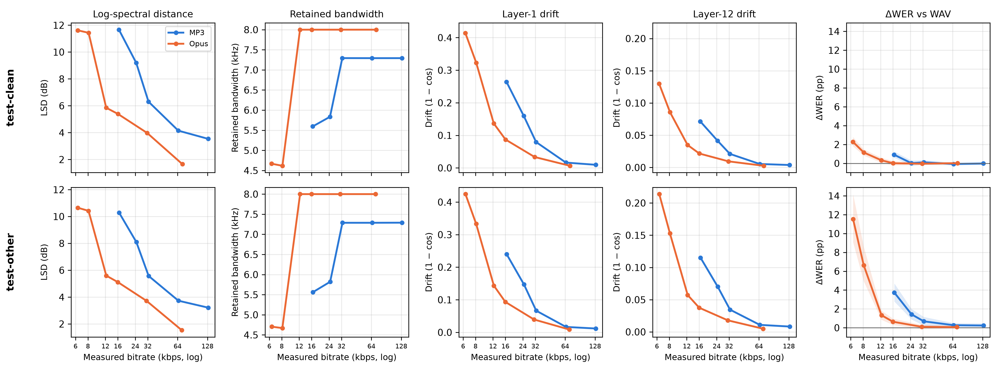
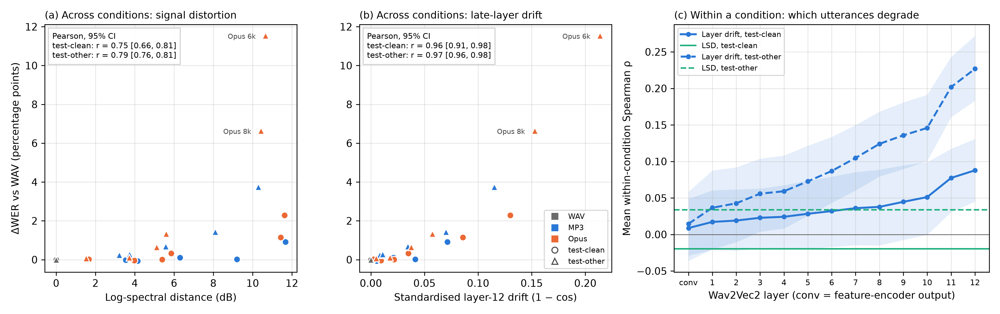

# Why Is Wav2Vec2 Robust to Lossy Audio Compression?

**ELEC5305 project | The University of Sydney**

This project studies how MP3 and Opus compression affect speech signals, Wav2Vec2 representations, and speech recognition errors. The same pretrained recogniser evaluates paired WAV and compressed versions of 500 utterances from each LibriSpeech test subset.

**Project website:** [Explore the project](https://surnamemei.github.io/elec5305-project-540077463/)

**Project report:** [PDF](FINAL_REPORT.pdf) · [Markdown](FINAL_REPORT.md) · [Report source](report/FINAL_REPORT.pandoc.md) · [Code guide](CODE_GUIDE.md) · [Reproducibility checklist](FINAL_REPORT_CHECKLIST.md)

## Main result

Measurable spectral distortion can appear before a clear change in recognition accuracy. On `test-clean`, MP3 at 24 kbps produced 9.2 dB log-spectral distance and an estimated retained bandwidth of about 5.8 kHz (using the report's −20 dB relative-power threshold), while the WER change was only +0.02 percentage points (speaker-level 95% CI includes zero). At the most aggressive Opus setting, 6 kbps, ΔWER was +2.28 points on `test-clean` and +11.53 points on `test-other`.

Across the 12 WAV/MP3/Opus conditions, layer-12 representation drift was more linearly associated with ΔWER than log-spectral distance (Pearson *r* = 0.96–0.97 vs 0.75–0.79). Within a fixed condition, the layer-12 association with which utterances failed was modest (mean Spearman ρ = 0.09 on `test-clean`, 0.23 on `test-other`). These are associations, not evidence of a causal mechanism.





## Experiment at a glance

- **Corpus:** LibriSpeech `test-clean` and `test-other`, 500 paired utterances per subset (seed `5305`).
- **Recognizer:** fixed `WAV2VEC2_ASR_BASE_960H`, greedy CTC decoding; no fine-tuning.
- **Conditions:** WAV baseline; MP3 at 128, 64, 32, 24, and 16 kbps; Opus at 64, 32, 16, 12, 8, and 6 kbps.
- **Measurements:** log-spectral distance, retained bandwidth, hidden-state drift through the convolutional encoder and 12 transformer layers, WER, error types, and speaker-level bootstrap intervals.

### Calibration note

Per-dimension hidden-state standardisation uses an unlabelled set of 100 selected `test-clean` utterances. This set overlaps the `test-clean` evaluation subset; no transcripts or recognition-error labels are used for calibration. The report lists this overlap as a limitation.

## Run the demonstration

The short demonstration re-runs two selected `test-clean` utterances through WAV and Opus 8 kbps, prints the reference and live ASR outputs, and saves spectrograms and audio files. It uses the case list and signal/representation measurements saved with the report; LSD and layer-12 drift are **not** recalculated by the demo.

Prerequisites: Python dependencies from `requirements.txt`, FFmpeg with `libopus`, and the LibriSpeech `test-clean` files under `data/LibriSpeech/test-clean/`. The TorchAudio model bundle may download on first use.

```bash
python src/video_demo.py --data-root data --output demo_assets --device cpu
```

Generated demo files are excluded from Git.

## Reproduce the analysis

Use Python 3.12 in Linux or WSL, plus FFmpeg built with `libmp3lame` and `libopus`.

```bash
python3 -m venv .venv
source .venv/bin/activate
pip install -r requirements.txt
```

`src/run_all_experiments.py` runs one subset, selected by `DATASET_NAME` near the top of the file (currently `test-other`). Run it once for each subset, setting that value to `test-clean` for the second run. The experiment scripts use `download=False` and expect the extracted LibriSpeech subsets under `data/LibriSpeech/`. Download them once with TorchAudio:

```bash
python -c "from torchaudio.datasets import LIBRISPEECH; [LIBRISPEECH('data', url=s, download=True) for s in ('test-clean', 'test-other')]"
```

The full ASR experiment and pretrained-model download can take substantially longer than the two-utterance demo. The downloaded data and caches are not tracked by Git.

After the experiment outputs are available, the analysis and report can be regenerated from the repository root:

```bash
python src/bootstrap_analysis.py
python src/error_analysis.py
python src/signal_distortion_analysis.py
python src/representation_analysis.py
python src/predictor_analysis.py
python src/integrated_analysis.py
python src/final_report_tables.py
python src/final_case_studies.py
python src/final_report_figures.py
bash report/build_report.sh
```

`report/build_report.sh` also requires Pandoc 3 or later and XeLaTeX. See [CODE_GUIDE.md](CODE_GUIDE.md) for the script-by-script workflow and [FINAL_REPORT_CHECKLIST.md](FINAL_REPORT_CHECKLIST.md) for the included result files and provenance notes.

## Related work

A separate unpublished manuscript by the author, [*Bandwidth Removal Reproduces Only Part of the ASR Penalty of 8-kbit/s Opus*](https://github.com/surnamemei/opus-asr-bandwidth-decomposition/blob/main/manuscript/taslp_submission.md), studies Opus at 8 kbit/s using a matched low-pass control and two ASR models. It uses different utterances from this course project but includes the same 73 LibriSpeech test speakers; the two analyses are therefore not independent at the speaker level. The manuscript was submitted to IEEE/ACM Transactions on Audio, Speech, and Language Processing (TASLP) and is under review as of 2026-11-06 (status confirmed by the author). Its results are not part of this course project's analysis.

## Repository map

- `src/` — experiment, analysis, figure, and live-demo scripts.
- `results/` — saved experiment outputs, report tables, and figures.
- `report/FINAL_REPORT.pandoc.md` — editable report source.
- `FINAL_REPORT.pdf` / `FINAL_REPORT.md` — rendered report formats.
- `index.md` — GitHub Pages project overview.

Downloaded data, virtual environments, caches, and generated demo files are not tracked.
